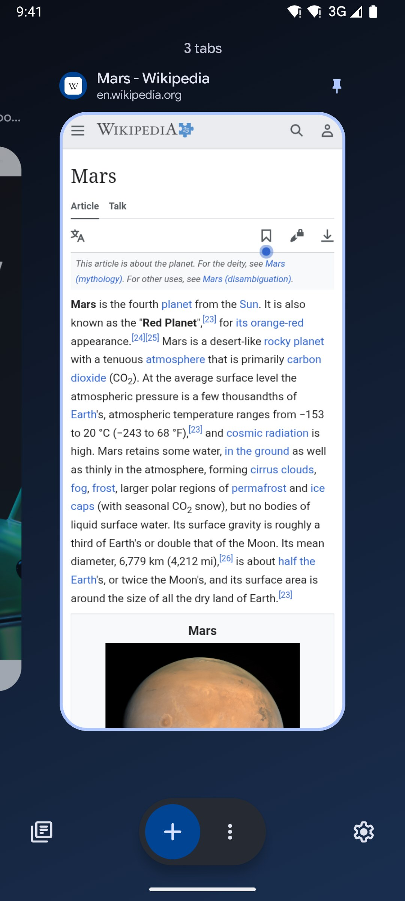
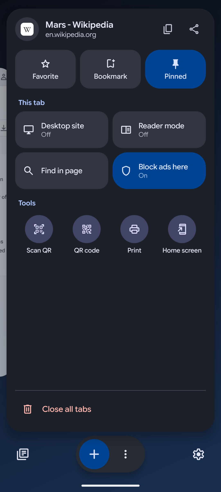
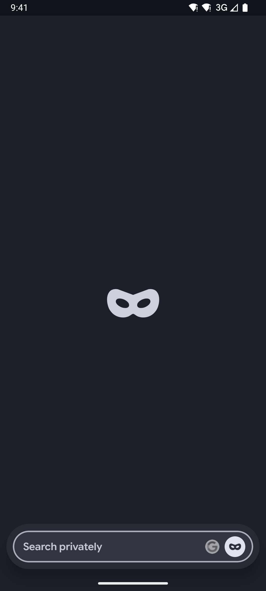

<h1 align="center">mi. Browser</h1>

<p align="center">
  <strong>A minimal, gesture-driven Android browser built around a single control: the Pill.</strong>
</p>

<p align="center">
  <a href="https://github.com/jleescy/mi-browser/releases/latest"></a>
  
  
  
</p>

<p align="center">
  
  
  
  
</p>

**mi.** (pronounced "my") replaces the usual toolbar with one floating **Pill**: tap it to search, swipe up for your tabs, swipe sideways to go back and forward, swipe down to hide it. It's written natively in Kotlin with Jetpack Compose, weighs under 3 MB, and keeps all of your data on your device.

**[Website](https://jleescy.github.io/mi-browser)** · **[User Guide](https://jleescy.github.io/mi-browser/user)** · **[Developer Guide](https://jleescy.github.io/mi-browser/developer)** · **[Download](https://github.com/jleescy/mi-browser/releases/latest)**

## Features

### The Pill
- One control for everything: search with suggestions (your past searches first), the tab switcher, back/forward and hiding the bar.
- **Search shortcuts**: start a search with `!w`, `!yt`, `!r`, `!a`, `!m` or `!i` to search Wikipedia, YouTube, Reddit, Amazon, Maps or Images, or `!se` to always search your search engine. The shortcut turns into a small pill as you type. Add your own in Settings, or set a custom search engine.
- **Pull down to refresh**, only ever from the very top of a page.
- A loading-progress fill, a "Not secure" marker on unencrypted pages, and a favorites bar.
- When hidden, a small recall button brings it back; you can pin it left, centre or right.

### Tab switcher
- Swipe up and the page zooms out into its card, like your phone's recent apps. The card's title and icon follow it from the first moment.
- Tabs are ordered by when you last used them, with live previews, on a soft gradient of your accent colour.
- Swipe a card up to close it (with undo). **Pin** a tab to keep it from being swiped away or closed by "Close all tabs".
- The **tab menu** (⋮) has Favorite, Bookmark and Pin; quick tiles for Desktop site, Reader mode and Find in page; and tools for QR codes, printing and home-screen shortcuts.

### Incognito
- Switch any new tab to incognito with the mask in the Pill, or long-press a link and choose **Open in Incognito Tab**.
- Every incognito tab has its own private storage. Logins and cookies never move between normal and incognito tabs, or between two incognito tabs.
- Nothing is recorded: no history, no recent searches, no restored tabs, no previews. Screenshots are blocked and the keyboard is asked not to learn what you type.
- Closing a tab erases its cookies, logins, site data and cache. A silent notification closes every incognito tab at once.

### A complete browser
- Sign-in and payment pop-ups (PayPal, Google), passkeys, Google Pay, HTTP sign-in prompts and client certificates.
- Bookmarks with folders, drag to reorder, swipe actions and search; history grouped by time or site.
- Pages' own Print and Share buttons, downloads, and local development sites (`localhost:3000`, LAN IPs, `.local`).

### Privacy & security
- Built-in ad and tracker blocking, optional third-party cookie blocking, HTTPS-only mode and Safe Browsing.
- Per-site camera, microphone and location prompts; pop-up blocking; confirmation before downloads or opening other apps; punycode display for look-alike domains.
- No tracking and no accounts. Site icons come from the sites themselves, never a third-party service.

### Material 3 Expressive
- Colours from your accent or your wallpaper (Material You) in light, dark or system theme.
- Google Sans Flex with an optional rounded style, Material Symbols, and spring-based motion that uses your display's full refresh rate.

## Installation
Download the latest APK from the **[Releases page](https://github.com/jleescy/mi-browser/releases/latest)** and open it on your phone. Requires Android 8.0 or newer. mi checks for new releases itself and offers to install them.

Long-press mi's icon for shortcuts to a new tab, a new incognito tab or the QR scanner.

## Building from source
Requirements: Android Studio (latest stable), or JDK 17+ with the Android SDK (compile SDK 37).

```bash
git clone https://github.com/jleescy/mi-browser.git
cd mi-browser
./gradlew installDebug          # build and install on a connected device (installs alongside the release app)
./gradlew testDebugUnitTest     # run the unit tests
./gradlew assembleRelease       # minified release APK → app/build/outputs/apk/release/
```

To sign release builds, add a git-ignored `keystore.properties` in the project root with `storeFile`, `storePassword`, `keyAlias` and `keyPassword`.

### Project layout
```
app/src/main/java/com/jlees/mibrowser/
├── MainActivity.kt       # edge-to-edge host, intents, permissions
├── BrowserViewModel.kt   # app state and actions
├── data/                 # models, storage, settings import/export, site icons
├── logic/                # URL parsing, tab history, bookmarks (unit tested)
├── web/                  # WebViewHost: one WebView per tab, incognito profiles
└── ui/                   # Compose UI: pill, tab switcher, sheets, history, bookmarks, settings, home, QR
docs/                     # project website (Next.js, deployed to GitHub Pages)
```

### Versioning
Releases follow `MAJOR.MINOR.PATCH`: major for ground-up changes (1.0 was the native rewrite), minor for significant new features, patch for fixes and smaller improvements.

The 0.x releases were built with React Native; their source is on the [`legacy`](https://github.com/jleescy/mi-browser/tree/legacy) branch.
