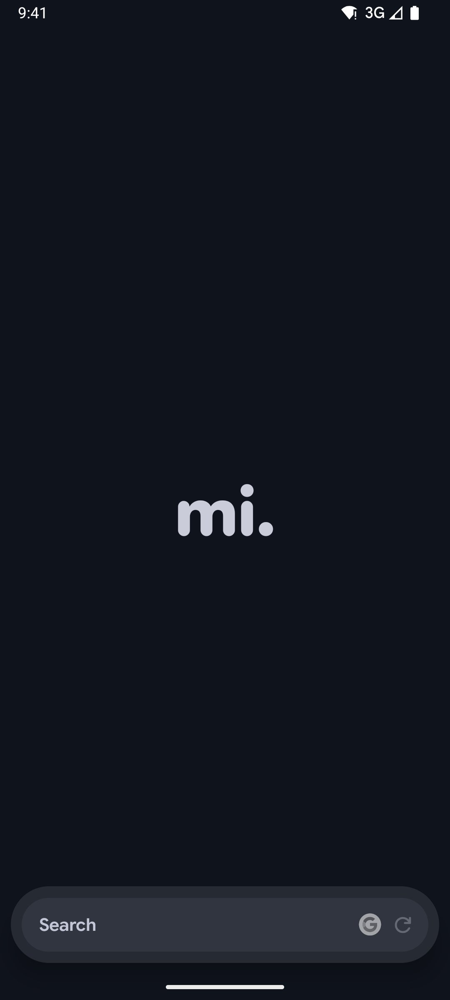
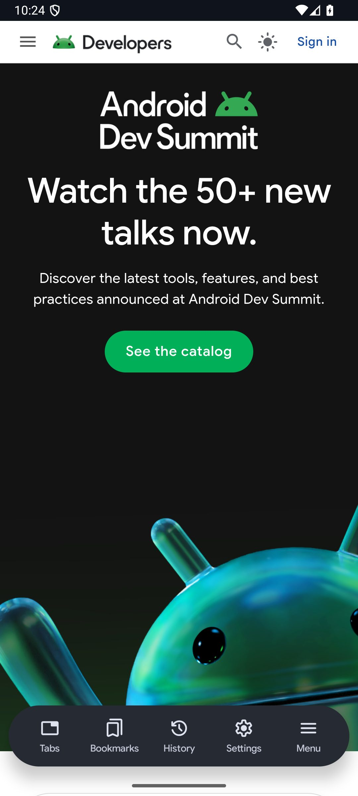
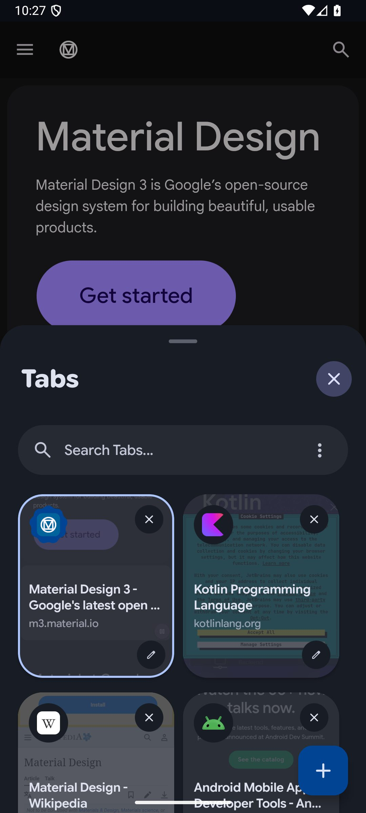
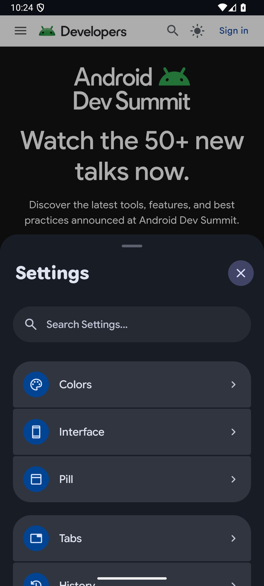

# mi. Browser 🌐

**mi.** (pronounced "my") is a hyper-lightweight, distraction-free Android browser. It replaces the traditional toolbar with a single, gesture-driven **Pill**, and is built natively in **Kotlin** with **Jetpack Compose** and **Material 3 Expressive**.

<p align="center">
  
  
  
  
</p>

## 🌐 Website
Features, screenshots and guides: **[jleescy.github.io/mi-browser](https://jleescy.github.io/mi-browser)**

- **[User Guide](https://jleescy.github.io/mi-browser/user)**: every gesture, tool and setting.
- **[Developer Guide](https://jleescy.github.io/mi-browser/developer)**: architecture, setup and builds.

## 🚀 Highlights
- **The Pill**: one control for everything. Tap to search (with suggestions), swipe up for the tab switcher, swipe sideways for back/forward, swipe down to hide it. The recall button can be pinned left, center or right.
- **Material 3 Expressive**: colors generated from your accent or your wallpaper (Material You), Light/Dark/System themes, Google Sans Flex (with an optional rounded style) and Material Symbols.
- **Tab switcher**: an app-switcher-style carousel of live tab previews. Swipe a card up to close it (with undo); quick actions, the tab menu, bookmarks and settings sit in the bottom bar.
- **Bookmarks & history**: folders, drag to reorder, swipe actions, search, and grouping by time or site.
- **Power tools**: find in page, QR scan (camera or image) and generate, reader mode, desktop mode, share and print.
- **Privacy & security**: built-in ad/tracker blocking, third-party cookies blocked, HTTPS-only mode, per-site camera/mic/location prompts, pop-up blocking, confirmation before downloads or opening other apps, punycode display for look-alike domains, Safe Browsing. No tracking; all data stays on your device.

## 📥 Installation
Download the latest APK from the **[Releases page](https://github.com/jleescy/mi-browser/releases)**. Requires Android 8.0+.

## 🛠️ Building from source
Requirements: Android Studio (latest stable) or JDK 17+ with Android SDK 37.

```bash
git clone https://github.com/jleescy/mi-browser.git
cd mi-browser
./gradlew installDebug          # build and install on a connected device
./gradlew testDebugUnitTest     # run the logic tests
./gradlew assembleRelease       # minified release APK → app/build/outputs/apk/release/
```

To sign release builds, add a git-ignored `keystore.properties` in the project root with `storeFile`, `storePassword`, `keyAlias` and `keyPassword`.

### Project layout
```
app/src/main/java/com/jlees/mibrowser/
├── MainActivity.kt       # edge-to-edge host, intents, permissions
├── BrowserViewModel.kt   # app state + actions
├── data/                 # models, storage, settings import/export
├── logic/                # URL parsing, tab history, bookmarks (unit tested)
├── web/                  # WebViewHost: one WebView per tab
└── ui/                   # Compose UI: pill, sheets, tabs, history, bookmarks, settings, home, QR
docs/                     # project website (Next.js, deployed to GitHub Pages)
```

The 0.x releases were built with React Native; 1.0 is a ground-up native rewrite. The old source is in git history at commit `c22a4d8`.

---
<p align="center">
  <em>A minimal masterpiece for the modern web.</em>
</p>
