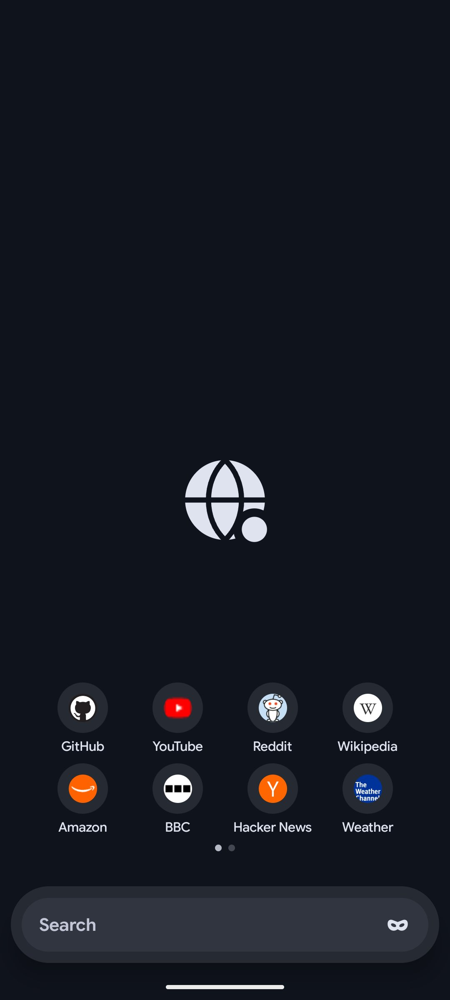
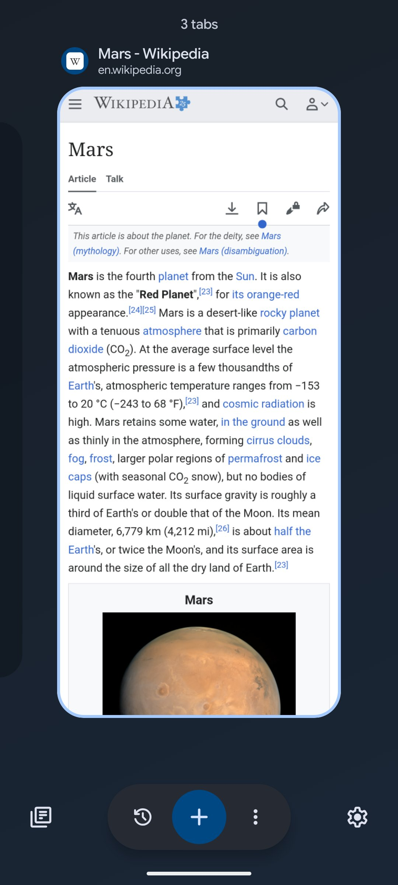
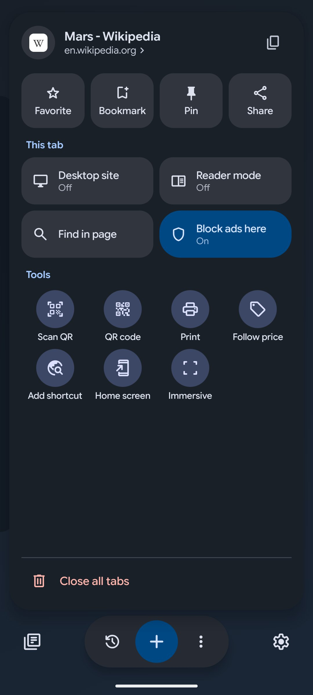
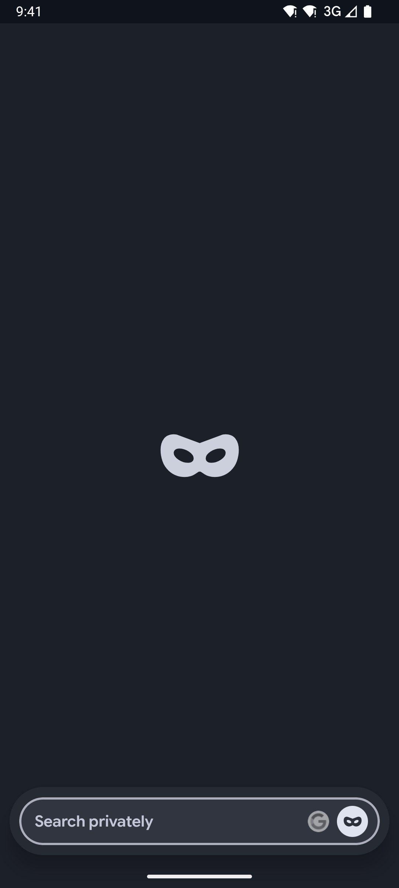

<h1 align="center">mi. Browser</h1>

<p align="center">
  <strong>A minimal, gesture-driven Android browser built around a single control: the Pill.</strong>
</p>

<p align="center">
  <a href="https://github.com/jleescy/mi-browser/releases/latest"></a>
  
  
  
  <a href="LICENSE"></a>
</p>

<p align="center">
  
  
  
  
</p>

**mi.** (pronounced "my") replaces the usual toolbar with one floating **Pill**: tap it to search, swipe up for your tabs, swipe sideways to go back and forward. It's written natively in Kotlin, weighs about 5 MB, and keeps all of your data on your phone.

**[Website](https://jleescy.github.io/mi-browser)** · **[User Guide](https://jleescy.github.io/mi-browser/user)** · **[Download](https://github.com/jleescy/mi-browser/releases/latest)**

## Highlights
- **One Pill for everything**: search with suggestions, inline answers (`20% of 150`, `5 km in mi`) and `!` shortcuts, plus back, forward and the tab switcher, all by swipe.
- **Tab switcher** with live previews, pinned tabs, tab search and undo.
- **Follow prices**: follow a product from the tab menu and mi tells you when it drops, goes on sale or comes back in stock, checked on your phone.
- **Built-in blocking** of ads, trackers and cookie banners, tracking-free links and HTTPS Only.
- **Incognito tabs**, each with its own private storage, erased when closed.
- **Fast downloads**, bookmarks with import and export, history, picture-in-picture and background playback.
- **Material 3 Expressive**: colours from your wallpaper, pure black dark mode, haptics and smooth motion.
- **No accounts, no tracking.** Everything stays on your device.

See everything mi does in the **[User Guide](https://jleescy.github.io/mi-browser/user)**.

## Install
Download the APK from the **[latest release](https://github.com/jleescy/mi-browser/releases/latest)** and open it on your phone (Android 8.0 or newer). mi checks for updates itself.

## Build from source
Requires Android Studio, or JDK 17+ with the Android SDK.

```bash
git clone https://github.com/jleescy/mi-browser.git
cd mi-browser
./gradlew installDebug         # build and install on a connected device
./gradlew testDebugUnitTest    # run the unit tests
```

How the code is organized is in the **[Developer Guide](https://jleescy.github.io/mi-browser/developer)** and [CLAUDE.md](CLAUDE.md).

## License
[MIT](LICENSE). The bundled filter lists, hosts list, font and icons keep their own licenses. mi. collects no personal data: see the [Privacy Policy](https://jleescy.github.io/mi-browser/privacy).
